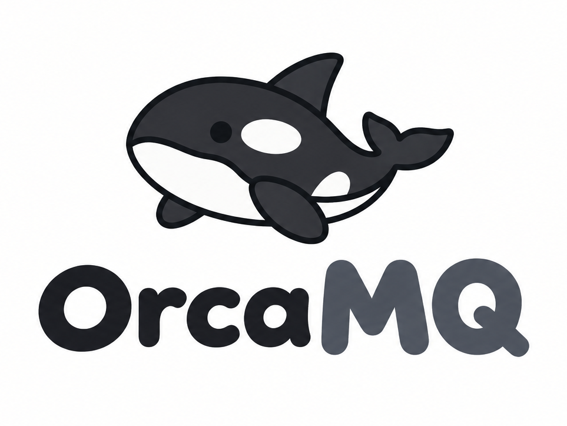

# OrcaMQ

<p align="center">
  
</p>

<p align="center">
  A lightweight, in-memory message broker built with <strong>Elixir and OTP</strong>.
  <br>
  It is inspired by the consumer group model of Redis Streams.
</p>

---

## Overview

OrcaMQ is a lightweight, in-memory message broker built with Elixir/OTP, combining the consumer group and acknowledgement model of Redis Streams with push-based message delivery inspired by Redis Pub/Sub.

It explores an alternative approach to message delivery using ETS and the concurrency model of the BEAM.

## Features

- **High Performance In-Memory Storage:** Powered by ETS (`:public`, `:ordered_set`, `:bag`) enabling concurrent read/write throughput without GenServer lock contention.
- **Push-based Consumers:** Internal subscribers are notified when messages arrive; configurable prefetch limits unacknowledged deliveries per consumer.
- **Retry Backoff:** NACKed or reclaimed messages use exponential retry delays capped by a configurable maximum.
- **Consumer Groups & PEL:** Tracks reading offsets per consumer group along with a Pending Entries List (PEL) to guarantee at-least-once message delivery.
- **TCP Server** — Expose a TCP interface for publishing and subscribing from applications written in different programming languages.
- **Docker Support** — Run OrcaMQ as a standalone service in a container.

## Architecture

OrcaMQ is built around three core ideas:

- **ETS for message storage:** Enables concurrent access without routing every storage operation through a single GenServer.
- **BEAM processes for coordination:** Separates broker responsibilities into concurrent processes.
- **Consumer groups and acknowledgements:** Track consumption progress and outstanding deliveries independently of message publishing.

The combination provides a practical foundation for exploring message delivery, consumer coordination, and fault-tolerant services in the Elixir ecosystem.

## Getting Started

### Prerequisites

- Elixir 1.14+
- Erlang/OTP 25+
- Docker and Docker Compose (for containerized deployment)

### Run with Docker

Build the image:

```bash
git clone https://github.com/hungle00/orca-mq.git
cd orca-mq

docker build -t orca-mq:latest .
```

Start the broker:

```bash
docker run -d \
  -p 5555:5555 \
  --name orcamq_server \
  orca-mq:latest
```

Alternatively, use Docker Compose:

```bash
docker compose up -d
```

The server should report a startup message similar to:

```text
OrcaMQ server running on 0.0.0.0:5555
```

## Client Documentation

- [Python Client Guide](clients/python/usage.md) — Run OrcaMQ with Docker and publish or consume messages using the Python client.

## Project Status

OrcaMQ is an independent project built to explore message broker design and Elixir/OTP concurrency.

Contributions, feedback, and ideas are welcome.

## License

See [LICENSE](LICENSE) for licensing information.
